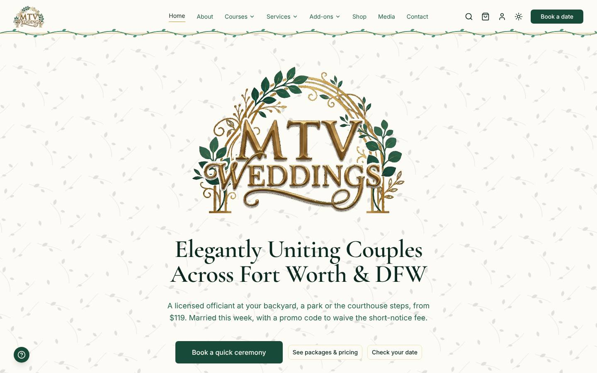
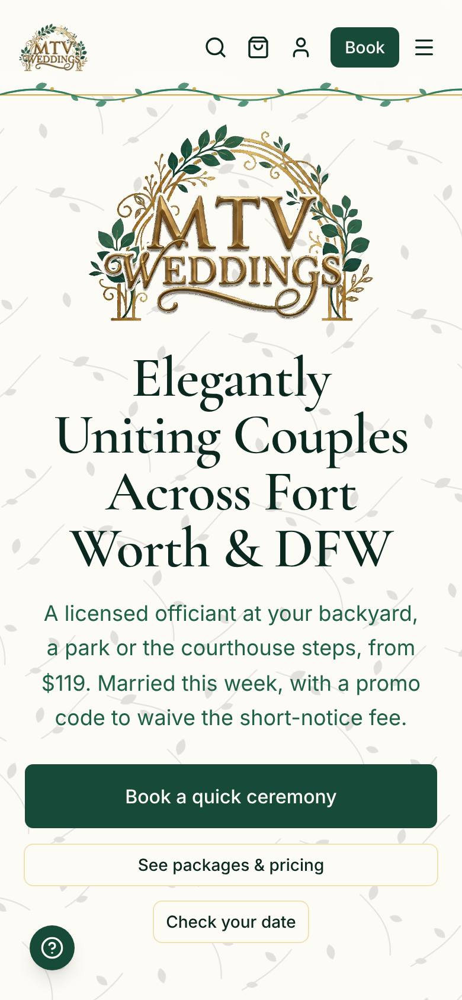

  

<h1 align="center"><a href="https://mtvweddings.com">MTV Weddings</a></h1>

  Wedding officiation, state approved premarital courses and wedding media across Fort Worth and the DFW metroplex. Couples can book a ceremony, take the Twogether in Texas course online, and get their photos and film back in a private vault. One site handles all of it, from the first enquiry to the anniversary shoot.

<strong>Live site:</strong> <a href="https://mtvweddings.com">mtvweddings.com</a>

  <a href="#what-it-is">What it is</a> · <a href="#services">Services</a> · <a href="#features">Features</a> · <a href="#book-or-get-in-touch">Book</a> · <a href="#connected-brands">Connected brands</a>

  
  
  
  
  

<table>
  <tr>
    <td align="center" valign="top">
       
      The home page on desktop, with the gilded arch mark and booking up front.
    </td>
    <td align="center" valign="top">
       
      The same page on a phone.
    </td>
  </tr>
</table>

## What it is

MTV Weddings is a wedding officiation and media studio in Fort Worth, Texas, run by Michael and V, an ordained minister. It marries couples, teaches the Twogether in Texas premarital course, and photographs and films the day. The wedding media is made through ZV Media, and the site itself was built by Zathena Ventures.

The site is more than a brochure. Couples can compare packages against local prices, add them to a cart, take a course online, and come back later to a private portal holding their course progress, certificate and delivered galleries.

## Services

Every package has its own page on the site. See the [full services overview](https://mtvweddings.com/services/).

### Ceremonies

- [Express Signing](https://mtvweddings.com/services/express-signing/)
- [Courthouse Ceremony](https://mtvweddings.com/services/courthouse-ceremony/)
- [Mobile Officiation](https://mtvweddings.com/services/mobile-officiation/)
- [Micro-Weddings](https://mtvweddings.com/services/micro-weddings/), including backyard micro-weddings
- [Elopements](https://mtvweddings.com/elope/)
- [Vow Renewal](https://mtvweddings.com/services/vow-renewal/)
- [Wedding Planning](https://mtvweddings.com/services/wedding-planning/) and the [Big Day Bundle](https://mtvweddings.com/services/big-day-bundle/)

### Media

- [Media Packages](https://mtvweddings.com/services/media-packages/), including a full ceremony with media, and a filterable [portfolio](https://mtvweddings.com/media/)
- [Anniversary Photoshoot](https://mtvweddings.com/services/anniversary-photoshoot/) and [Anniversary Getaway](https://mtvweddings.com/services/anniversary-getaway/)
- [Add-ons](https://mtvweddings.com/services/addons/) for any package

### Courses

- **[Twogether in Texas](https://mtvweddings.com/twogether/)**: the state approved premarital course, with the license discount and the waiting-period waiver explained, in [Non-Religious](https://mtvweddings.com/courses/twogether-non-religious/), [Christian](https://mtvweddings.com/courses/twogether-christian/), [Jewish](https://mtvweddings.com/courses/twogether-jewish/) and [LGBTQ](https://mtvweddings.com/courses/twogether-lgbtq/) versions. It can also be booked [with an officiant](https://mtvweddings.com/services/twogether-in-texas/)
- **Coming soon**: [Parenting Together](https://mtvweddings.com/courses/parenting/), [Conflict Resolution](https://mtvweddings.com/courses/conflict-resolution/) and a Name Change Kit

## Features

### Planning and booking

- **Honest pricing**: a pricing grid sets each package against real local market ranges, with add-to-cart instead of an email popup
- **One cart for everything**: services, courses and merch together, kept between visits
- **Course discount on merch**: a course in the cart takes 10% off anything from the [shop](https://mtvweddings.com/shop/)
- **Site search**: one search box covers pages, services and courses

### Courses

- **Course marketplace**: search and filter by category or format on the [courses page](https://mtvweddings.com/courses/)
- **Same-day certificate**: the certificate of completion generates when the last module is done
- **Six months of access**: counted from the day payment cleared, with the closing date shown on every course card
- **Money-back guarantee**: 30 days, on the course fee
- **Progress that sticks**: the course player remembers where you left off

### For couples

- **Passwordless sign-in**: a magic link to your email
- **Account pairing**: link your account to your partner's, and either of you can open every course the other paid for
- **Private media vault**: delivered galleries with a photo grid, full-size lightbox and highlight reels, plus a note when work is still being edited

### The site

- **Day and night themes**: cream and emerald by day, deep emerald and gold by night, remembered between visits
- **Floating help**: help and back-to-top on every page
- **Learn more**: [About](https://mtvweddings.com/about/), [Reviews](https://mtvweddings.com/reviews/), [FAQs](https://mtvweddings.com/faqs/), [Inspirations](https://mtvweddings.com/inspirations/) and [Partners](https://mtvweddings.com/partners/)

## Book or get in touch

Use the [contact page](https://mtvweddings.com/contact/) to ask about a date, or start from the [services overview](https://mtvweddings.com/services/) and add a package to your cart.

## Connected brands

- **[Zathena Ventures](https://zathenaventures.xyz)**: built the MTV Weddings site and landing pages ([public repo](https://github.com/ZATHENA-VENTURES/ZathenaVentures-Public))
- **[ZV Media](https://github.com/ZATHENA-VENTURES/ZVMedia-Public)**: the film, video, photography and sound brand that produces MTV Weddings media

## License

© 2026 MTV Weddings. All rights reserved.

## Credits & Contact

Website and landing pages by [Zathena Ventures](https://zathenaventures.xyz). Wedding media through [ZV Media](https://github.com/ZATHENA-VENTURES/ZVMedia-Public).

Website: [mtvweddings.com](https://mtvweddings.com) · Contact: [mtvweddings.com/contact](https://mtvweddings.com/contact/)

> This is the public showcase of a private repository. It presents the project, its features and its live site, and leaves out source code and deployment details.
